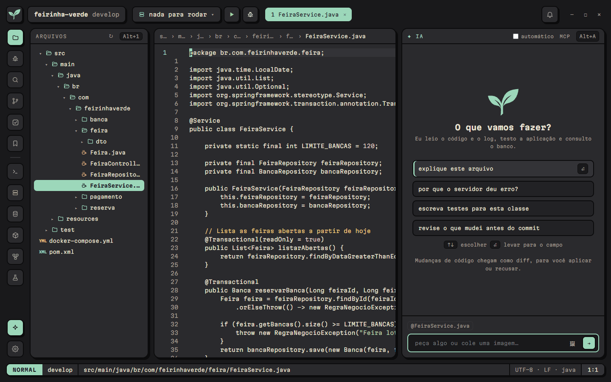
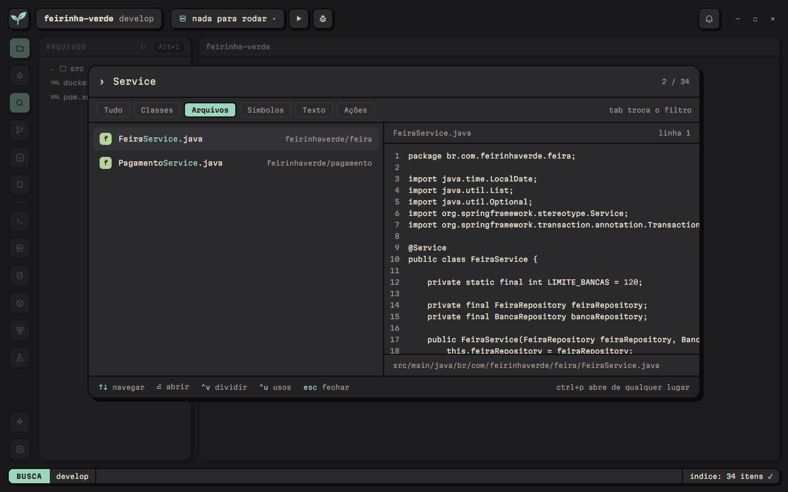
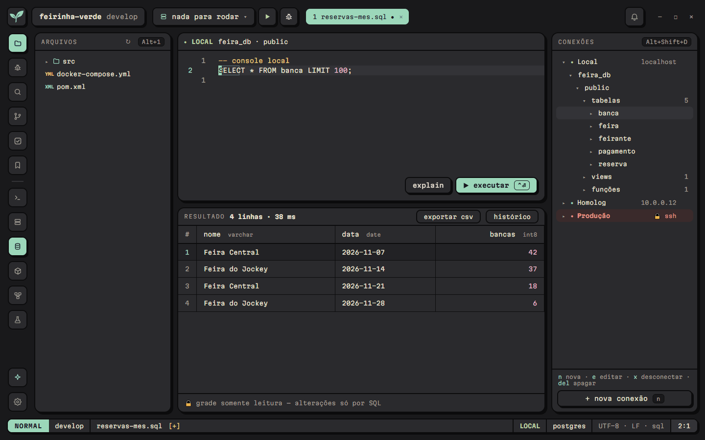
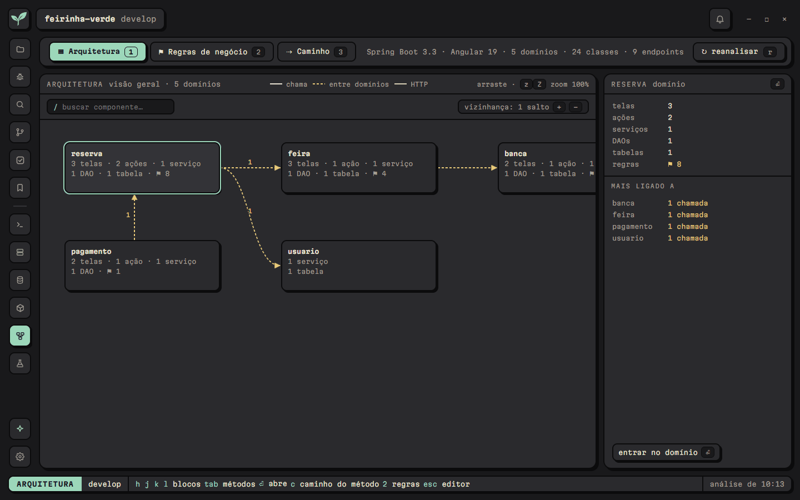
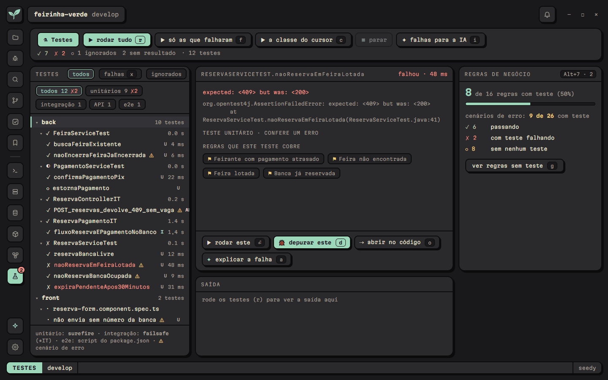
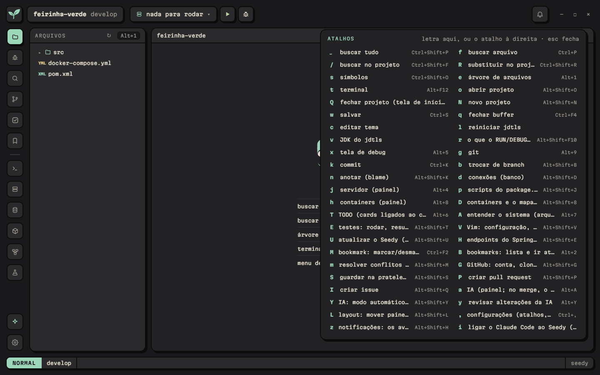

<p align="center">
  
</p>

<h1 align="center">Seedy</h1>

<p align="center">
  <b>IDE para Java, Angular e React, guiada pelo teclado.</b><br>
  Leve, com o visual sob o seu controle, para Windows e Linux.
</p>

<p align="center">
  <a href="https://github.com/Node-23/Seedy/releases/latest"><b>Baixar a última versão</b></a> ·
  <a href="docs/GUIA.md">Guia completo</a> ·
  <a href="ROADMAP.md">Roadmap</a>
</p>



## Por que o Seedy

O Seedy junta o que se usa no dia a dia de um projeto web em Java (código, Git, banco, servidor,
containers, testes) numa janela só, pensada para não precisar do mouse. Os atalhos seguem o IntelliJ,
o editor tem modo Vim, e não há sistema de plugins: cada funcionalidade já vem pronta e integrada.

Feito com **Tauri 2 (Rust)**, **Angular** e **Monaco**.

## O que ele faz

### Código

Editor Monaco com **modo Vim**, editor dividido e inteligência de Java pelo jdtls: erros enquanto
você digita, completar com import automático, ir para definição, usos, renomear e gerar código.
Angular, React e TypeScript têm servidor de linguagem e Prettier. O destaque de sintaxe é discreto,
no estilo Alabaster.

Três buscas como no IntelliJ: arquivo (`Ctrl+P`), projeto (`Ctrl+Shift+F`) e substituir
(`Ctrl+Shift+R`).



### Banco de dados

PostgreSQL, MySQL e Oracle, com túnel SSH, console SQL, autocompletar e senhas guardadas no cofre do
sistema. Conexões de produção aparecem destacadas.



### Entender o sistema

A arquitetura do projeto em blocos, as **regras de negócio** achadas no código (e quais têm teste) e o
caminho de um método, da tela até a tabela. Para Spring Boot, Java EE/Jakarta, Struts e Angular.



### Testes

Rode tudo, só o que falhou ou a classe do cursor, depure um teste sozinho e veja quais regras cada um
cobre.



### E também

- **Git**: log com grafo, commit com diff, merge em 3 colunas, prateleira (*shelf*), blame, e conta do
  GitHub para clonar, abrir pull requests e issues.
- **Servidores**: JBoss/WildFly e Tomcat, com deploy, hot swap, log e depuração.
- **Depurador** Java e web, com breakpoints condicionais, variáveis e console.
- **Containers**: os containers do projeto, o mapa de quem fala com quem, logs e terminal.
- **Endpoints do Spring**: a lista lida do código, com chamada na aplicação local.
- **Completar enquanto digita (opcional)**: sugestões em texto fantasma, com um modelo que roda no seu
  computador (grátis, o código não sai dele) ou pela API da Anthropic. O Seedy pergunta na primeira abertura.
- **IA (opcional)**: o Claude dentro da IDE, ou o Claude Code ligado a ela. Mudanças de código chegam
  como diff para você aceitar ou recusar.
- **Terminal integrado**, TODO e bookmarks por projeto, variáveis do `.env`, novo projeto
  (Spring Boot, Java, Angular, React) e atualização automática.

### Teclado primeiro

Toda ação tem atalho, e o menu (`Ctrl+Shift+Espaço`) lista todas. Os atalhos podem ser trocados.



| Atalho | Ação |
|---|---|
| `Ctrl+P` | buscar arquivo |
| `Ctrl+Shift+F` | buscar no projeto |
| `Alt+1` / `Alt+F12` | arquivos / terminal |
| `Alt+9` / `Ctrl+K` | Git / commit |
| `Alt+Shift+D` | banco de dados |
| `Alt+Shift+T` | testes |
| `Alt+A` | painel de IA |
| `Alt+↑` / `Alt+↓` | mais um cursor acima / abaixo |
| `Alt+clique` | criar ou tirar um cursor (`Esc` volta a um) |
| `Alt+Shift+↑` / `Alt+Shift+↓` | mover a linha |
| `Ctrl+,` | configurações |

O tema (cores, fontes e formas) é um arquivo JSON que você edita e vê mudar na hora.

## Instalar

Baixe em [**Releases**](https://github.com/Node-23/Seedy/releases/latest):

| Sistema | Arquivo | Atualiza sozinho |
|---|---|---|
| Windows 10/11 | `Seedy_x.y.z_x64-setup.exe` (recomendado) | sim |
| Windows, sem instalar | `Seedy_x.y.z_x64_portable.exe` | não |
| Linux | `.AppImage` (recomendado) | sim |
| Linux (pacotes) | `.deb` ou `.rpm` | não |

O instalador do Windows não é assinado, então o SmartScreen pode avisar. Cada release traz o
`SHA256SUMS.txt` para você conferir o download.

### O que mais você precisa

- **Git**, para as telas de Git.
- **JDK 25 ou mais novo**, para a inteligência de Java ([Adoptium](https://adoptium.net)). É só para
  rodar o jdtls: o seu projeto continua compilando na versão dele.
- **Node.js**, para projetos Angular e React.
- **Docker**, para a tela de containers; **Oracle Instant Client**, só para conexões Oracle.

Na primeira vez num projeto Java, o Seedy baixa o jdtls sozinho.

## Privacidade

O Seedy não tem telemetria. Ele usa a rede para procurar atualização no GitHub, baixar as ferramentas
que precisa e para o que você pedir (GitHub, bancos, IA). Com a IA, o que você envia na conversa e o
que ela lê do projeto vai para a Anthropic. O completar local não envia nada; o completar pela API envia o
trecho em volta do cursor (nunca de arquivos como `.env` e chaves).

Se o próprio Seedy falhar, você pode enviar o relatório para análise: ele só sai quando você aperta o
botão, dá para ver o texto antes, e senhas e o nome do seu usuário são mascarados.

## Compilar do código

Precisa de Node.js 20+, Rust estável e das bibliotecas do
[Tauri](https://tauri.app/start/prerequisites/).

```bash
npm install
npm run dev          # abre em modo desenvolvimento
npm run empacotar    # gera os instaladores
```

Detalhes e testes no [guia](docs/GUIA.md#compilar-e-testar).

## Estado do projeto

Projeto pessoal, em desenvolvimento ativo. Falhas e sugestões são bem-vindas nas
[issues](https://github.com/Node-23/Seedy/issues).

## Licença

[PolyForm Noncommercial 1.0.0](LICENSE.md): uso, estudo e modificação livres para fins **não
comerciais**. Uso comercial não é permitido.

Copyright (c) 2026 Matheus Vinicius Linhares.
